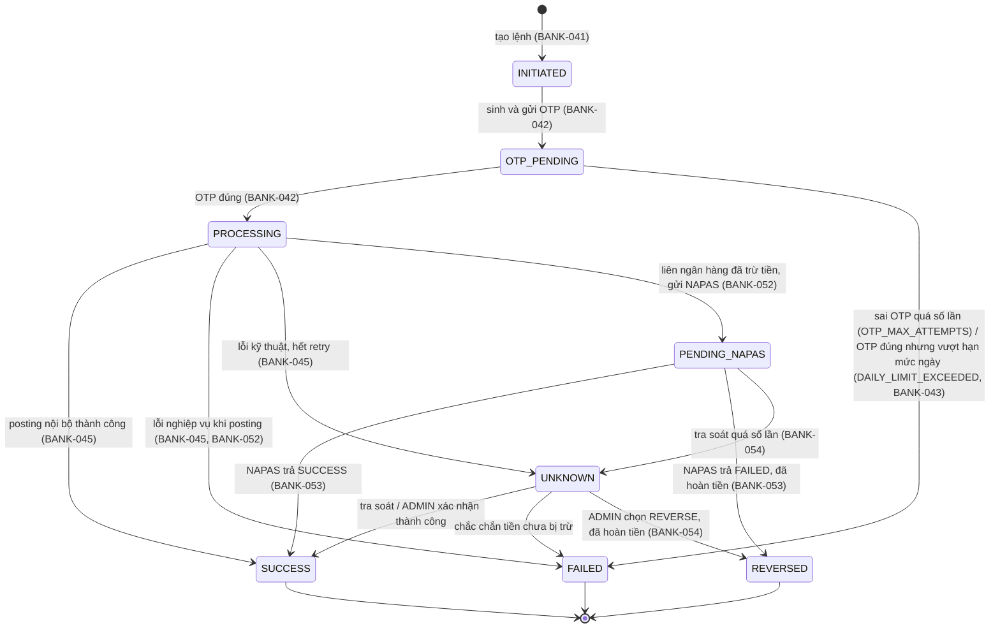

# Máy trạng thái lệnh chuyển khoản

> Service: `transfer-service`, migration `V2__create_transfer_and_transfer_status_history_tables.sql` (BANK-040).
> Code: enum `TransferStatus` (bảng chuyển hợp lệ), `TransferType#supports` (trạng thái theo loại lệnh), entity `Transfer`.

## 1. Sơ đồ

## 2. Quy tắc

| Quy tắc | Chi tiết |
|---|---|
| Trạng thái cuối | `SUCCESS`, `FAILED`, `REVERSED`: không chuyển tiếp được nữa |
| `UNKNOWN` | **Không** phải trạng thái cuối: chờ tra soát hoặc ADMIN xử lý tay |
| Chỉ liên ngân hàng | `PENDING_NAPAS`, `REVERSED`. Lệnh `INTERNAL` không bao giờ vào hai trạng thái này |
| `FAILED` | Chỉ khi **chắc chắn** tiền chưa bị trừ, luôn kèm `FAILURE_CODE` (CHECK `CK_TRANSFER_FAILURE_CODE`). Tiền đã trừ mà giao dịch không thành → `REVERSED` sau khi hoàn tiền |
| Giữ nguyên trạng thái | Không được tính là một lần chuyển (ví dụ gửi lại OTP vẫn ở `OTP_PENDING`, không ghi lịch sử) |
| Chuyển không hợp lệ | `BusinessException` mã `INVALID_STATUS_TRANSITION` (HTTP 422), trạng thái và lịch sử không đổi |

## 3. Lịch sử trạng thái

Mọi lần đổi trạng thái, kể cả lúc tạo lệnh, thêm một dòng `TRANSFER_STATUS_HISTORY`:

| Cột | Ý nghĩa |
|---|---|
| `PREVIOUS_STATUS` | Trạng thái trước; `NULL` ở dòng đầu tiên (lệnh vừa tạo, `STATUS = INITIATED`) |
| `STATUS` | Trạng thái sau |
| `FAILURE_CODE` | Mã lỗi khi chuyển sang `FAILED` |
| `CHANGED_AT` | Thời điểm đổi (UTC), bằng `TRANSFER.UPDATED_AT` của lần đổi đó |

Dòng lịch sử do entity `Transfer` tạo trong `changeStatus` / `fail` và được ghi xuống DB cùng transaction với lệnh
(quan hệ `@OneToMany` cascade `PERSIST`), nên code ở tầng `application` không thể đổi trạng thái mà quên ghi lịch sử.
